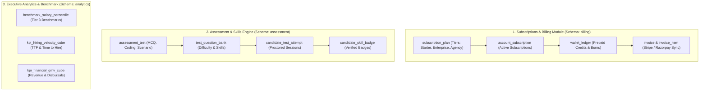

# Talentra: Full Architecture Blueprint, Improvisation Plan & Phase 3 Roadmap

**Platform:** Talentra — Enterprise Talent & Demand Management Platform  
**Architecture Horizon:** Phase 1 (Foundation) + Phase 2 (Enterprise Tenancy & Gigs) + Phase 3 (Subscriptions, Assessment & Intelligence)  
**Total Current Footprint:** 123 Tables | 111 Indexes | 18 Functions | 78 Triggers across 6 Domain Schemas  
**Quality Engineering Standard:** QFE / DDD Lifecycle (Gates G1–G8)  

---

## 1. End-to-End System Flow (Cross-Module Orchestration)

The diagram below illustrates how data and business processes traverse across all 6 schemas currently in production, leading into the planned Phase 3 subsystems:

```mermaid
flowchart TD
    subgraph S1["1. Master Data (Shared Catalog)"]
        MD_GEO["Geographies (country, state, city)"]
        MD_SKILL["Skills & Taxonomy"]
        MD_CURR["Currencies (ISO-4217) & I18N"]
        MD_CAT["service_category"]
    end

    subgraph S2["2. Administration (IAM & Privacy)"]
        ADM_USER["user_account"]
        ADM_AUTH["user_credential & MFA"]
        ADM_RBAC["user_role & role_permission"]
        ADM_CONSENT["consent_purpose & record"]
        ADM_BLOCK["user_block & organisation_block"]
    end

    subgraph S3["3. Profile (Talent Supply)"]
        PROF_CORE["candidate_profile"]
        PROF_EXP["candidate_experience & education"]
        PROF_DOC["resume_document & portfolio"]
    end

    subgraph S4["4. Organisation (Corporate Tenancy)"]
        ORG_CORE["organisation & account"]
        ORG_LOC["organisation_location (HQ / Branches)"]
        ORG_SEC["organisation_identifier (AES Encrypted)"]
        ORG_REC["organisation_recruiter (EXCLUDE Overlap)"]
        ORG_HIER["organisation_relationship (Acyclic CTE)"]
        ORG_AUD["audit_event (Monthly Range Partitions)"]
    end

    subgraph S5["5. Recruitment (Traditional Hiring)"]
        REC_REQ["job_requirement"]
        REC_APP["job_application & pipeline"]
        REC_INT["job_interview & feedback"]
        REC_OFF["job_offer & revision"]
    end

    subgraph S6["6. Gig Marketplace (On-Demand Gigs)"]
        GIG_WRK["gig_worker_profile & services"]
        GIG_AVL["gig_worker_availability (Calendar GIST)"]
        GIG_REQ["gig_request (Fixed / Rate-based)"]
        GIG_APP["gig_application (Self-App Prevention)"]
        GIG_ASG["gig_assignment (Positions Cap Trigger)"]
        GIG_PAY["gig_earnings_reference & history"]
        GIG_RAT["gig_rating (Bi-directional Feedback)"]
    end

    subgraph S7["7. Planned Phase 3 Subsystems"]
        P3_SUB["Subscriptions, Credits & Wallet Ledger"]
        P3_ASS["Proctored Assessment & Verification Engine"]
        P3_INT["Executive Intelligence & Analytical Cubes"]
    end

    %% Key Linkages
    ADM_USER -->|1:1 Bridge| PROF_CORE
    ADM_USER -->|Actor/Admin| ORG_CORE
    ADM_USER -->|Freelancer| GIG_WRK
    ORG_CORE -->|Tenancy Scope| REC_REQ
    ORG_CORE -->|Sponsor| GIG_REQ
    PROF_CORE -->|Candidate Applies| REC_APP
    GIG_WRK -->|Worker Bids| GIG_APP
    MD_SKILL -.-> PROF_CORE & REC_REQ & GIG_WRK
    MD_CAT -.-> GIG_WRK & GIG_REQ

    %% Phase 3 Integration Vectors
    ORG_CORE ==>|Enterprise Billing Account| P3_SUB
    GIG_REQ -.->|credit_ledger_entry_id| P3_SUB
    PROF_CORE ==>|Candidate Test Runs| P3_ASS
    ORG_AUD & REC_APP & GIG_PAY ==>|Data Telemetry| P3_INT
```



---

## 2. Complete Schema Inventory Till Now (123 Tables)

### Schema 1: `master_data` (24 Tables)
1. `country` — ISO 3166-1 alpha-2/alpha-3 country codes and calling prefixes.
2. `state` — Administrative subdivisions with composite FK `(state_id, country_id)`.
3. `city` — Municipalities with composite FK `(city_id, state_id)`.
4. `location` — Standardized geo-coordinate addresses with WGS84 coordinates.
5. `currency` — ISO 4217 standard currency dictionary (`code char(3)`).
6. `exchange_rate` — Historical and live exchange rates for cross-border transactions.
7. `tax_rate` — Jurisdiction-specific taxation rules (GST, VAT, Sales Tax).
8. `language` — ISO 639-1 language catalog with default system language fallback.
9. `ui_label` — System-wide UI label keys decoupled from localized text.
10. `ui_translation_key` — Hierarchical translation keys for platform frontends.
11. `ui_translation` — Per-language localized translations.
12. `industry` — Standard Industrial Classification (SIC) / NAICS industry sectors.
13. `job_function` — Corporate functional areas (Engineering, Finance, Marketing).
14. `job_role` — Standard job title catalog mapped to job functions.
15. `seniority_level` — Junior, Mid, Senior, Staff, Principal, Director, Executive.
16. `employment_type` — Full-time, Part-time, Contract, Internship, Seasonal.
17. `work_mode` — Remote, Onsite, Hybrid.
18. `education_degree` — Normalized academic degrees (B.S., M.S., Ph.D., B.Tech).
19. `institution` — Accredited colleges, universities, and educational institutes.
20. `skill_category` — High-level domain categorization of technical and soft skills.
21. `skill` — Normalized skills ontology with canonical names.
22. `skill_alias` — Common synonyms, acronyms, and alternative spellings.
23. `skill_matrix` — Skill-to-skill adjacency and relatedness graph.
24. `service_category` — Freelance service taxonomy for the Gig Marketplace.

### Schema 2: `profile` (18 Tables)
25. `candidate_profile` — Master talent profile linked 1:1 with `administration.user_account`.
26. `candidate_contact` — Secondary phone, alternate email, and notification settings.
27. `candidate_address` — Primary physical residential location.
28. `candidate_education` — Academic degrees with dates and GPA/grades.
29. `candidate_work_experience` — Employment tenure history with company, title, achievements.
30. `candidate_skill` — Candidate self-declared skills with proficiency ratings (1–5).
31. `candidate_certification` — Professional accreditations (AWS, PMP, CISSP) with expiry.
32. `candidate_license` — Government / statutory practice licenses.
33. `profile_project` — Showcase projects with URLs and repository links.
34. `resume_template` — System-provided layout definitions for PDF resume builder.
35. `resume_document` — Generated and uploaded candidate CV documents.
36. `candidate_portfolio` — Media artifacts, GitHub links, Figma design boards.
37. `candidate_language` — Multi-language spoken/written proficiency levels.
38. `candidate_preference` — Desired job titles, expected salary ranges, target locations.
39. `candidate_award` — Industry honors, hackathon awards, and scholarships.
40. `candidate_bookmark` — Saved requisitions and company bookmarks.
41. `candidate_referral` — Peer-to-peer referral links with bounty tracking.
42. `profile_view_history` — Append-only telemetry log of recruiter profile views.

### Schema 3: `recruitment` (13 Tables)
43. `job_requirement` — Requisition postings with salary bands and employment types.
44. `job_requirement_skill` — Mandatory and optional skills per job opening.
45. `job_benefit` — Company compensation perks (Health Insurance, Equity, 401k).
46. `job_questionnaire` — Custom application screening question sets.
47. `job_question` — Individual screening questions (Text, Multiple Choice, Boolean).
48. `job_question_option` — Predefined choices for multi-choice questionnaire items.
49. `candidate_question_answer` — Candidate submissions to screening questions.
50. `job_application` — Formal requisition submissions with ATS stage tracking.
51. `application_status_history` — Append-only lifecycle progression history.
52. `job_pipeline_stage` — Configurable Kanban hiring stages per requisition.
53. `job_shortlist` — Recruiter curated candidate shortlists and candidate pools.
54. `job_interview` — Scheduled interview rounds with calendar integration.
55. `interview_feedback` — Structured interviewer scorecards, ratings, and notes.

### Schema 4: `administration` (17 Tables)
56. `user_account` — Canonical login identity with brute-force defense counters.
57. `user_credential` — Argon2id password hashes and federated OIDC/SAML subjects.
58. `account_token` — Single-use cryptographic tokens (reset, OTP, magic link).
59. `user_mfa_factor` — Enrolled 2FA authenticators (TOTP, WebAuthn Passkeys, SMS).
60. `mfa_backup_code` — Single-use hashed emergency recovery codes.
61. `role` — System role dictionary (super_admin, recruiter, candidate, etc.).
62. `permission` — Atomic capability tokens (`audit.read`, `requisition.publish`).
63. `user_role` — Temporal role assignments with valid windows and revocation.
64. `role_permission` — Role-to-permission entitlement matrix.
65. `identity_session` — Authenticated bearer sessions with token hashes and telemetry.
66. `service_api_key` — Machine-to-machine integration credentials for ATS/HRIS.
67. `consent_purpose` — Master legal purpose catalog (DPDP Act 2023 / GDPR).
68. `consent_record` — Immutable affirmative grant/withdrawal decision ledger.
69. `system_setting` — Centralized operational runtime configuration knobs.
70. `audit_event` — Append-only security and authorization audit log.
71. `user_block` — Directional candidate-to-user blocking.
72. `organisation_block` — Candidate-to-organisation blocking.

### Schema 5: `organisation` (24 Tables)
73. `organisation_status` — Reference lookup: `pending_verification`, `active`, `suspended`, `closed`.
74. `organisation_type` — Reference lookup: `employer`, `client`, `staffing_agency`, etc.
75. `company_size_band` — Reference lookup: `size_1_10` to `size_5001_plus`.
76. `account_type` — Reference lookup: `employer`, `agency`, `consultant`, `campus`.
77. `account_status` — Reference lookup: `pending`, `active`, `suspended`, `closed`.
78. `verification_type` — Reference lookup: `company_registration`, `tax_identifier`, `domain_ownership`.
79. `verification_provider` — Reference lookup: `registry_api`, `tax_api`, `dns_check`, `manual_review`.
80. `verification_status` — Reference lookup: `pending`, `in_review`, `verified`, `rejected`, `expired`.
81. `audit_action` — Reference lookup: `row_insert`, `recruiter_assigned`, `access_denied`, etc.
82. `identifier_type` — Tax format catalog with regex validation patterns (GSTIN, PAN, CIN, EIN).
83. `organisation_relationship_type` — Parent-subsidiary, franchise, affiliate, joint venture.
84. `verification_status_transition` — Legal verification state machine matrix.
85. `organisation` — Employer and client company profiles.
86. `account` — Platform tenancy accounts (One live account per organization).
87. `account_administrator` — Authorized tenant administrators with zero-overlap exclusion.
88. `organisation_location` — Physical offices and headquarters with composite geographic FKs.
89. `organisation_identifier` — AES-256-GCM encrypted tax identifiers with HMAC-SHA256 fingerprints.
90. `organisation_domain` — Verified corporate internet domains and challenge tokens.
91. `organisation_verification` — Identity verification cases with idempotency tracking.
92. `organisation_verification_history` — Append-only legal status transition history.
93. `organisation_recruiter` — Effective-dated recruiter assignments with zero-overlap exclusion.
94. `recruiter_assignment_history` — Append-only recruiter mapping audit trail.
95. `organisation_relationship` — Corporate hierarchies with recursive CTE cycle protection.
96. `audit_event` — Monthly range-partitioned forensic audit log (`p202610` to `p202703`).

### Schema 6: `gig` (27 Tables)
97. `lk_gig_availability_status` — Lookup: `accepting_work`, `unavailable`, `paused`.
98. `lk_gig_visibility_status` — Lookup: `public`, `private`, `unlisted`.
99. `lk_gig_work_mode` — Lookup: `remote`, `onsite`, `hybrid`.
100. `lk_gig_pricing_type` — Lookup: `fixed_price`, `rate_based`.
101. `lk_gig_rate_unit` — Lookup: `hour`, `day`, `project`, `month`.
102. `lk_gig_request_status` — Lookup: `draft`, `published`, `paused`, `closed`, `cancelled`.
103. `lk_gig_application_status` — Lookup: `pending`, `accepted`, `rejected`, `withdrawn`.
104. `lk_gig_assignment_status` — Lookup: `pending_handoff`, `active`, `completed`, `terminated`, `disputed`.
105. `lk_gig_proficiency_level` — Lookup: `beginner`, `intermediate`, `expert`.
106. `gig_status_transition` — Valid state machine transitions for requests, proposals, assignments.
107. `gig_worker_profile` — Freelance worker identity, portfolio, and experience.
108. `gig_worker_service` — Multi-rate catalog offerings with currency validation.
109. `gig_worker_skill` — Skill tags mapped to master data ontology.
110. `gig_worker_availability` — Calendar availability windows with `EXCLUDE USING gist` zero-overlap.
111. `gig_request` — Requisitions with fixed or rate-based pricing shape checks.
112. `gig_request_skill` — Required skill criteria for gig fulfillment.
113. `gig_request_status_history` — Append-only gig requisition lifecycle trail.
114. `gig_application` — Freelancer proposals with anti-gaming self-application prevention.
115. `gig_application_status_history` — Append-only proposal review audit history.
116. `gig_assignment` — Executed delivery contract with atomic positions cap enforcement.
117. `gig_assignment_status_history` — Append-only contract milestone progression log.
118. `gig_fulfilment_reference` — External delivery system links (GitHub, Jira, Figma).
119. `gig_fulfilment_event` — Webhook delivery events with idempotency deduplication.
120. `gig_earnings_reference` — Financial escrow and payout tracking per assignment.
121. `gig_earnings_history` — Append-only immutable disbursement ledger.
122. `gig_worker_list_entry` — Recruiter talent favorites and private contractor shortlists.
123. `gig_rating` — Bi-directional 5-star performance ratings and verified reviews.

---

## 3. Phase 3 Design Blueprint & Implementation Flow

Phase 3 transitions Talentra from talent discovery to **monetization, assessment verification, and executive intelligence**.



### Module 1: Subscriptions, Credits & Invoicing (`billing` schema — 8 Tables)
1. `billing.subscription_plan` — Tier definitions (Starter, Pro, Enterprise, Recruiter Unlimited).
2. `billing.plan_entitlement` — Usage quotas (Monthly job postings, candidate resume views, API rate limits).
3. `billing.account_subscription` — Active subscriptions linked to `organisation.account(id)`.
4. `billing.wallet_ledger` — Double-entry credit balance and transaction burn ledger.  
   *(Wires directly to `gig.gig_request.credit_ledger_entry_id` and `profile.profile_view_history.credit_deducted`).*
5. `billing.invoice` — Statutory VAT/GST invoices generated for subscription renewals and marketplace fees.
6. `billing.invoice_item` — Itemized line items per invoice.
7. `billing.payment_transaction` — Payment gateway receipts (Stripe, Razorpay, Bank Transfer) with idempotency keys.
8. `billing.payment_method` — Tokenized customer payment instruments.

### Module 2: Proctored Candidate Assessment Engine (`assessment` schema — 8 Tables)
1. `assessment.assessment_test` — Standardized skill tests linked to `master_data.skill(id)`.
2. `assessment.test_question_bank` — Versioned test questions with difficulty scoring and rubrics.
3. `assessment.test_question_option` — Multiple-choice options and auto-grading criteria.
4. `assessment.candidate_test_attempt` — Candidate proctored test sessions with timer bounds.
5. `assessment.candidate_test_response` — Submitted code snippets, answers, and execution traces.
6. `assessment.proctor_telemetry` — Anti-cheating telemetry (Tab switching, webcam pings, copy-paste count).
7. `assessment.candidate_skill_badge` — Cryptographically signed verifiable talent badges linked to `profile.candidate_skill`.
8. `assessment.assessment_provider` — Third-party assessment APIs (HackerRank, Codility, TestGorilla).

### Module 3: Executive Intelligence & Tier 3 Benchmarks (`analytics` schema — 6 Tables)
1. `analytics.benchmark_salary_percentile` — Tier 3 market salary benchmarks by role, location, and seniority.
2. `analytics.benchmark_company_rating` — Aggregated corporate reputation and employer review scores.
3. `analytics.kpi_hiring_velocity_cube` — Pre-aggregated time-to-fill and pipeline stage drop-off metrics.
4. `analytics.kpi_marketplace_gmv_cube` — Gross Merchandise Value (GMV), freelancer billings, and platform take-rates.
5. `analytics.kpi_recruiter_productivity_cube` — Requisitions closed, candidate acceptance ratios.
6. `analytics.executive_dashboard_snapshot` — C-Suite pre-calculated metrics powering instant executive dashboards.

---

## 5. Phased Rollout Sequence

```text
Phase 1 Foundation [COMPLETED & PROVEN]
└── 54 Tables across master_data, profile, recruitment.
    └── Status: 100% Tested & Verified.

Phase 2 Enterprise Tenancy & Gigs [COMPLETED & PUSHED]
└── 69 Tables across administration, organisation, gig.
    └── Status: Pushed to git (commit "phase 2"). All 27 regression suites passing.

Phase 3 Execution Strategy [NEXT STEPS]
├── Milestone 1: Subscriptions & Billing Module (B36–B39)
│   ├── DDL: sql/phase3_billing.sql (8 Tables)
│   ├── Wire: gig_request.credit_ledger_entry_id -> billing.wallet_ledger.id
│   └── Seed & Test: sql/seed_billing.sql & billing_regression_test.sql
├── Milestone 2: Proctored Assessment Engine (B40–B43)
│   ├── DDL: sql/phase3_assessment.sql (8 Tables)
│   ├── Wire: candidate_skill_badge -> profile.candidate_skill.id
│   └── Seed & Test: sql/seed_assessment.sql & assessment_regression_test.sql
└── Milestone 3: Executive Analytics & Tier 3 Benchmarks (B44–B46)
    ├── DDL: sql/phase3_analytics.sql (6 Tables)
    ├── Views & Cubes: Pre-aggregated executive analytics views
    └── Final Validation: 145+ Total Platform Tables Regression Engine
```
