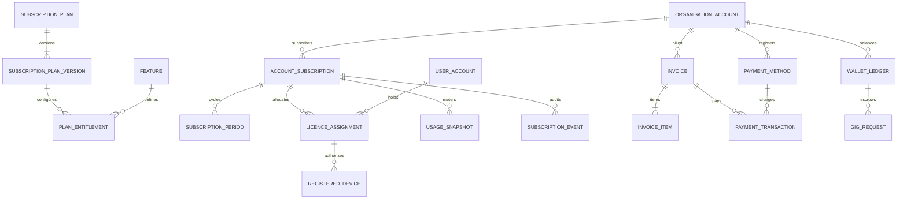

# Talentra Enterprise Database Architecture
## Phase 3 — Module 1: Billing, Licensing & Subscription Subsystem Specification

---

## 1. Executive Summary & Purpose

The **Billing & Licensing Subsystem (`billing`)** provides the commercial engine, software license enforcement, multi-seat allocation, device telemetry validation, financial accounting, and append-only credit wallet infrastructure for the Talentra platform.

### Core Architectural Responsibilities
1. **Commercial Product Catalog & Plan Versioning**: Supports versioned commercial subscription plans (`subscription_plan`, `subscription_plan_version`) ensuring existing tenants keep historical pricing and SLAs when plans evolve.
2. **Typed Feature Entitlements Matrix**: Governs feature access (`feature`, `plan_entitlement`) with strictly enforced database-level typing (boolean, integer, numeric, text).
3. **Tenant Subscription Lifecycle**: Binds billable tenancy directly to `organisation.account(id)` with a strict partial unique index guaranteeing at most one active commercial subscription per account.
4. **Recruiter Seat & Device Licensing**: Manages named user seat assignments (`licence_assignment`) and hardware device authentication tokens (`registered_device`) hashed with SHA-256 (`bytea`).
5. **Usage Metering**: Tracks feature consumption snapshots (`usage_snapshot`) across discrete temporal windows.
6. **Invoicing & Double-Entry Payment Transactions**: Manages itemized billing (`invoice`, `invoice_item`), payment transactions (`payment_transaction`), and saved PCI-compliant tokenized payment methods (`payment_method`).
7. **Immutable Financial Credit Wallet**: Provides an append-only, transaction-safe credit ledger (`wallet_ledger`) guarded by PL/pgSQL triggers against any `UPDATE` or `DELETE` mutations.
8. **Subscription Lifecycle Event Stream**: Captures structured audit payloads (`subscription_event`) for billing governance.
9. **Cross-Phase Integration Seam**: Connects `gig.gig_request(credit_ledger_entry_id)` to `billing.wallet_ledger(id)`.

---

## 2. Integration Contract with Phases 1 & 2

| Upstream Schema / Entity | Downstream Billing Reference | Architectural Rule |
| :--- | :--- | :--- |
| `organisation.account(id)` | `billing.account_subscription(account_id)`, `billing.invoice(account_id)`, `billing.wallet_ledger(account_id)`, `billing.payment_method(account_id)` | **Billable Boundary**: Invoicing and credit balances belong exclusively to corporate accounts, never individual entities. |
| `administration.user_account(id)` | `billing.licence_assignment(user_account_id)`, `created_by`, `updated_by`, `actor_user_id` | **Canonical Identity**: All user attribution and seat allocations reference the centralized platform user account. |
| `administration.identity_session(id)` | Application Middleware Session Verification | **Separation of Concerns**: Session lifecycle remains owned by `administration`; billing validates device registration and active seat without duplicating session storage. |
| `master_data.currency(code)` | `subscription_plan_version(currency_code)`, `invoice(currency_code)`, `payment_transaction(currency_code)` | **ISO Reference Currency**: Strictly adheres to the global currency master catalog. |
| `gig.gig_request(credit_ledger_entry_id)` | `billing.wallet_ledger(id)` | **Escrow Hook**: Freelance and gig job postings reference wallet transactions for automated milestone escrow. |

---

## 3. Entity-Relationship Diagram (Mermaid)



---

## 4. Entity Catalog & Data Specifications (15 Tables)

### 4.1 `billing.subscription_plan`
Master commercial tier catalog (e.g. Starter, Growth, Enterprise).
* `id`: `bigint GENERATED ALWAYS AS IDENTITY PRIMARY KEY`
* `plan_code`: `varchar(60) NOT NULL UNIQUE` (Checked via regex `^[a-z][a-z0-9_]*$`)
* `plan_name`: `varchar(150) NOT NULL`
* `description`: `text NULL`
* `is_active`: `boolean NOT NULL DEFAULT true`
* Standard audit timestamps and actor FKs (`created_at`, `updated_at`, `created_by`, `updated_by`)

### 4.2 `billing.subscription_plan_version`
Immutable commercial pricing and terms per release.
* `id`: `bigint GENERATED ALWAYS AS IDENTITY PRIMARY KEY`
* `subscription_plan_id`: `bigint NOT NULL REFERENCES billing.subscription_plan(id)`
* `version_number`: `integer NOT NULL` (Checked `> 0`)
* `currency_code`: `char(3) NOT NULL REFERENCES master_data.currency(code)`
* `base_price`: `numeric(12,2) NOT NULL` (Checked `>= 0`)
* `billing_interval_code`: `varchar(20) NOT NULL` (`'month'`, `'year'`, `'one_time'`)
* `interval_count`: `smallint NOT NULL DEFAULT 1`
* `trial_days`: `integer NOT NULL DEFAULT 0`
* `effective_from`: `timestamptz NOT NULL`
* `effective_until`: `timestamptz NULL`
* `is_sellable`: `boolean NOT NULL DEFAULT true`

### 4.3 `billing.feature`
Master dictionary of chargeable or policy-governed capabilities.
* `id`: `bigint GENERATED ALWAYS AS IDENTITY PRIMARY KEY`
* `feature_code`: `varchar(80) NOT NULL UNIQUE` (Checked via regex `^[a-z][a-z0-9_]*$`)
* `feature_name`: `varchar(150) NOT NULL`
* `feature_type_code`: `varchar(20) NOT NULL` (`'boolean'`, `'integer'`, `'numeric'`, `'text'`)
* `unit_code`: `varchar(40) NULL` (e.g. `seats`, `searches`, `devices`)

### 4.4 `billing.plan_entitlement`
Value allocation matrix per feature per plan version.
* `id`: `bigint GENERATED ALWAYS AS IDENTITY PRIMARY KEY`
* `subscription_plan_version_id`: `bigint NOT NULL REFERENCES billing.subscription_plan_version(id)`
* `feature_id`: `bigint NOT NULL REFERENCES billing.feature(id)`
* `boolean_value`: `boolean NULL`
* `integer_value`: `bigint NULL`
* `numeric_value`: `numeric(18,4) NULL`
* `text_value`: `text NULL`
* **Integrity Guard**: `chk_entitlement_one_value` ensures exactly 1 column is non-null.
* **Trigger Guard**: `trg_plan_entitlement_type` verifies the chosen column exactly matches `feature.feature_type_code`.

### 4.5 `billing.account_subscription`
Tenant subscription state.
* `id`: `bigint GENERATED ALWAYS AS IDENTITY PRIMARY KEY`
* `account_id`: `bigint NOT NULL REFERENCES organisation.account(id)`
* `subscription_plan_version_id`: `bigint NOT NULL REFERENCES billing.subscription_plan_version(id)`
* `status_code`: `varchar(20) NOT NULL DEFAULT 'pending'` (`pending`, `trialing`, `active`, `past_due`, `paused`, `cancelled`, `expired`)
* `current_period_start`, `current_period_end`: `timestamptz NULL` (Checked `current_period_end > current_period_start`)
* `idempotency_key`: `varchar(120) NULL UNIQUE`
* `external_provider_code`, `external_subscription_reference`: `varchar` (Provider idempotency)
* **Partial Unique Index**: `uq_account_one_live_subscription` enforces at most one active subscription in (`trialing`, `active`, `past_due`, `paused`) per account.

### 4.6 `billing.subscription_period`
Historical ledger of billing cycle periods.
* `id`: `bigint GENERATED ALWAYS AS IDENTITY PRIMARY KEY`
* `account_subscription_id`: `bigint NOT NULL REFERENCES billing.account_subscription(id)`
* `period_start`, `period_end`: `timestamptz NOT NULL` (Checked `period_end > period_start`)
* `period_status_code`: `varchar(20) NOT NULL DEFAULT 'open'` (`open`, `invoiced`, `paid`, `void`, `closed`)

### 4.7 `billing.licence_assignment`
User seat assignment per subscription.
* `id`: `bigint GENERATED ALWAYS AS IDENTITY PRIMARY KEY`
* `account_subscription_id`: `bigint NOT NULL REFERENCES billing.account_subscription(id)`
* `user_account_id`: `bigint NOT NULL REFERENCES administration.user_account(id)`
* `assigned_at`: `timestamptz NOT NULL DEFAULT CURRENT_TIMESTAMP`
* `revoked_at`: `timestamptz NULL`
* `revoked_by`: `bigint NULL REFERENCES administration.user_account(id)`
* `revoke_reason_code`: `varchar(40) NULL`
* **Partial Unique Index**: `uq_licence_active_user_per_subscription` guarantees a user holds at most 1 active seat per subscription.
* **Revocation Integrity**: `chk_licence_assignment_revocation` requires all 3 revocation fields (`at`, `by`, `reason`) together.

### 4.8 `billing.registered_device`
Hardware device authentication telemetry linked to a seat.
* `id`: `bigint GENERATED ALWAYS AS IDENTITY PRIMARY KEY`
* `account_subscription_id`: `bigint NOT NULL REFERENCES billing.account_subscription(id)`
* `licence_assignment_id`: `bigint NOT NULL REFERENCES billing.licence_assignment(id)`
* `device_identifier_hash`: `bytea NOT NULL UNIQUE` (Strictly 32-byte SHA-256 hash)
* `device_label`: `varchar(120) NULL`
* `status_code`: `varchar(20) NOT NULL DEFAULT 'active'` (`active`, `revoked`, `blocked`)
* **Trigger Guard**: `trg_registered_device_subscription` verifies that the device and license assignment belong to the same subscription.

### 4.9 `billing.usage_snapshot`
Aggregated usage measurement within discrete time windows.
* `id`: `bigint GENERATED ALWAYS AS IDENTITY PRIMARY KEY`
* `account_subscription_id`: `bigint NOT NULL REFERENCES billing.account_subscription(id)`
* `feature_id`: `bigint NOT NULL REFERENCES billing.feature(id)`
* `window_start`, `window_end`: `timestamptz NOT NULL`
* `quantity`: `numeric(18,4) NOT NULL` (Checked `>= 0`)
* **Unique Window Constraint**: `uq_usage_snapshot` prevents duplicate measurements for the same window.

### 4.10 `billing.payment_method`
Tokenized, PCI-compliant payment instruments.
* `id`: `bigint GENERATED ALWAYS AS IDENTITY PRIMARY KEY`
* `account_id`: `bigint NOT NULL REFERENCES organisation.account(id)`
* `provider_code`: `varchar(30) NOT NULL` (`stripe`, `razorpay`, `adyen`)
* `provider_payment_method_reference`: `varchar(255) NOT NULL`
* `method_type_code`: `varchar(30) NOT NULL` (`card`, `bank_transfer`, `mandate`, `wallet`, `upi`)
* `last_four_digits`: `char(4) NULL` (Checked regex `^[0-9]{4}$`)
* `expiry_month`, `expiry_year`: `smallint NULL`
* `is_default`, `is_active`: `boolean NOT NULL`

### 4.11 `billing.invoice`
Commercial invoice header.
* `id`: `bigint GENERATED ALWAYS AS IDENTITY PRIMARY KEY`
* `account_id`: `bigint NOT NULL REFERENCES organisation.account(id)`
* `account_subscription_id`: `bigint NULL REFERENCES billing.account_subscription(id)`
* `invoice_number`: `varchar(80) NOT NULL UNIQUE`
* `status_code`: `varchar(20) NOT NULL DEFAULT 'draft'` (`draft`, `issued`, `partially_paid`, `paid`, `void`, `uncollectible`)
* `currency_code`: `char(3) NOT NULL REFERENCES master_data.currency(code)`
* `subtotal_amount`, `tax_amount`, `total_amount`: `numeric(12,2) NOT NULL`
* **Arithmetic Constraint**: `chk_invoice_total` guarantees `total_amount = subtotal_amount + tax_amount`.

### 4.12 `billing.invoice_item`
Itemized line-item charges.
* `id`: `bigint GENERATED ALWAYS AS IDENTITY PRIMARY KEY`
* `invoice_id`: `bigint NOT NULL REFERENCES billing.invoice(id)`
* `line_number`: `integer NOT NULL`
* `item_type_code`: `varchar(30) NOT NULL` (`subscription`, `usage`, `credit`, `adjustment`, `tax`)
* `quantity`: `numeric(12,4) NOT NULL DEFAULT 1`
* `unit_amount`, `line_amount`: `numeric(12,2) NOT NULL`
* **Arithmetic Constraint**: `chk_invoice_item_math` guarantees `line_amount = round(quantity * unit_amount, 2)`.

### 4.13 `billing.payment_transaction`
Gateway charge attempts.
* `id`: `bigint GENERATED ALWAYS AS IDENTITY PRIMARY KEY`
* `invoice_id`: `bigint NOT NULL REFERENCES billing.invoice(id)`
* `payment_method_id`: `bigint NULL REFERENCES billing.payment_method(id)`
* `provider_code`: `varchar(30) NOT NULL`
* `idempotency_key`: `varchar(120) NOT NULL`
* `status_code`: `varchar(20) NOT NULL DEFAULT 'pending'` (`pending`, `authorized`, `succeeded`, `failed`, `cancelled`, `refunded`, `partially_refunded`)
* `settled_at`: `timestamptz NULL` (Checked: required if succeeded/refunded)
* **Uniqueness**: Composite `(provider_code, idempotency_key)` guarantees zero double-charge risk.

### 4.14 `billing.wallet_ledger`
Append-only, immutable credit transaction ledger.
* `id`: `bigint GENERATED ALWAYS AS IDENTITY PRIMARY KEY`
* `account_id`: `bigint NOT NULL REFERENCES organisation.account(id)`
* `entry_type_code`: `varchar(30) NOT NULL` (`grant`, `purchase`, `consume`, `expire`, `refund`, `adjustment`)
* `quantity`: `numeric(18,4) NOT NULL` (Checked `<> 0`)
* `unit_code`: `varchar(40) NOT NULL`
* `source_type_code`: `varchar(40) NOT NULL`
* `source_id`: `bigint NOT NULL`
* `idempotency_key`: `varchar(120) NOT NULL`
* `metadata`: `jsonb NOT NULL DEFAULT '{}'`
* **Immutable Append-Only Trigger**: `trg_wallet_ledger_append_only` completely raises an exception on any `UPDATE` or `DELETE`.

### 4.15 `billing.subscription_event`
Lifecycle event stream for state changes and webhooks.
* `id`: `bigint GENERATED ALWAYS AS IDENTITY PRIMARY KEY`
* `account_subscription_id`: `bigint NOT NULL REFERENCES billing.account_subscription(id)`
* `event_code`: `varchar(60) NOT NULL`
* `payload`: `jsonb NOT NULL DEFAULT '{}'`
* **Immutable Append-Only Trigger**: `trg_subscription_event_append_only` prevents any tampering with the audit log.

---

## 5. Concurrency & Quota Enforcement Contracts

### 5.1 Recruiter Seat Cap Enforcement
Seat quotas are stored in `billing.plan_entitlement` under `seats_limit`.
To prevent race conditions during seat assignment:
1. Application begins a database transaction.
2. Acquires an exclusive row lock on the parent subscription:
   ```sql
   SELECT id FROM billing.account_subscription WHERE id = :sub_id FOR UPDATE;
   ```
3. Queries the current active seat count:
   ```sql
   SELECT COUNT(*) FROM billing.licence_assignment 
   WHERE account_subscription_id = :sub_id AND revoked_at IS NULL;
   ```
4. If `count >= quota`, the application rejects the allocation. Otherwise, it executes the `INSERT`.

### 5.2 Device Limit Enforcement
Registered device quotas are governed under `devices_per_user_limit`.
1. Exclusive lock on the `licence_assignment`:
   ```sql
   SELECT id FROM billing.licence_assignment WHERE id = :assignment_id FOR UPDATE;
   ```
2. Compares active devices against limit before inserting `billing.registered_device`.

---

## 6. Operational Views Layer

1. **`billing.v_active_subscription`**:
   Denormalizes live tenant subscriptions with plan names, current price, currency, interval, and renewal period dates.
2. **`billing.v_account_wallet_balance`**:
   Dynamically aggregates credit ledger transactions (`grant + purchase + refund - consume - expire`) to provide real-time balances per account and currency unit.
3. **`billing.v_seat_allocation`**:
   Calculates active seat allocation metrics per corporate subscription for admin dashboards.

---

## 7. Automated Test Verification Summary

The module is verified by **21 regression test scenarios (`BIL-001` through `BIL-021`)** in [`sql/billing_licensing_regression_test.sql`](file:///c:/Users/hp/OneDrive/Desktop/talencia1/talentra-database-design/sql/billing_licensing_regression_test.sql) executed under transaction-isolated rollback guarantees.

* **Score**: 100.0% Pass Rate across all 36 platform suites in `run_all_tests.py`.
* **Zero Duplication**: Validated against `DUP-001..DUP-005`.
